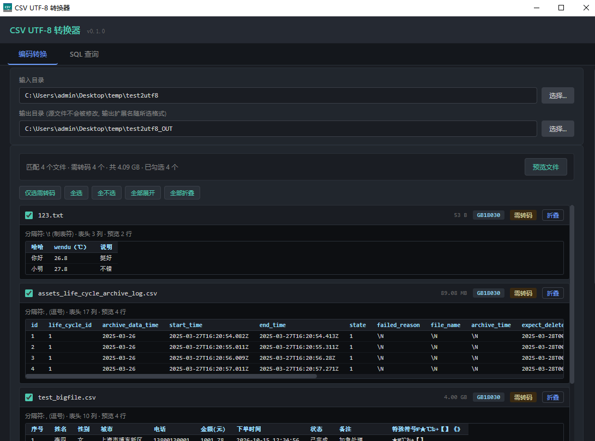
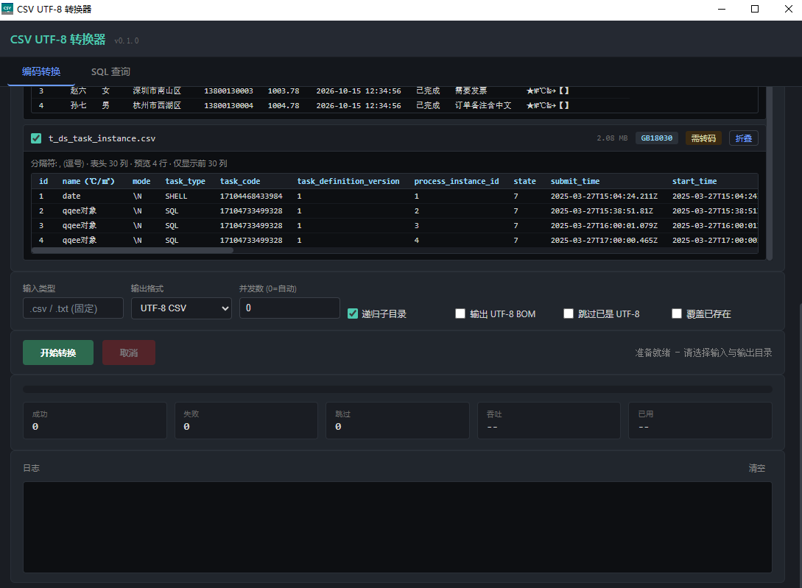
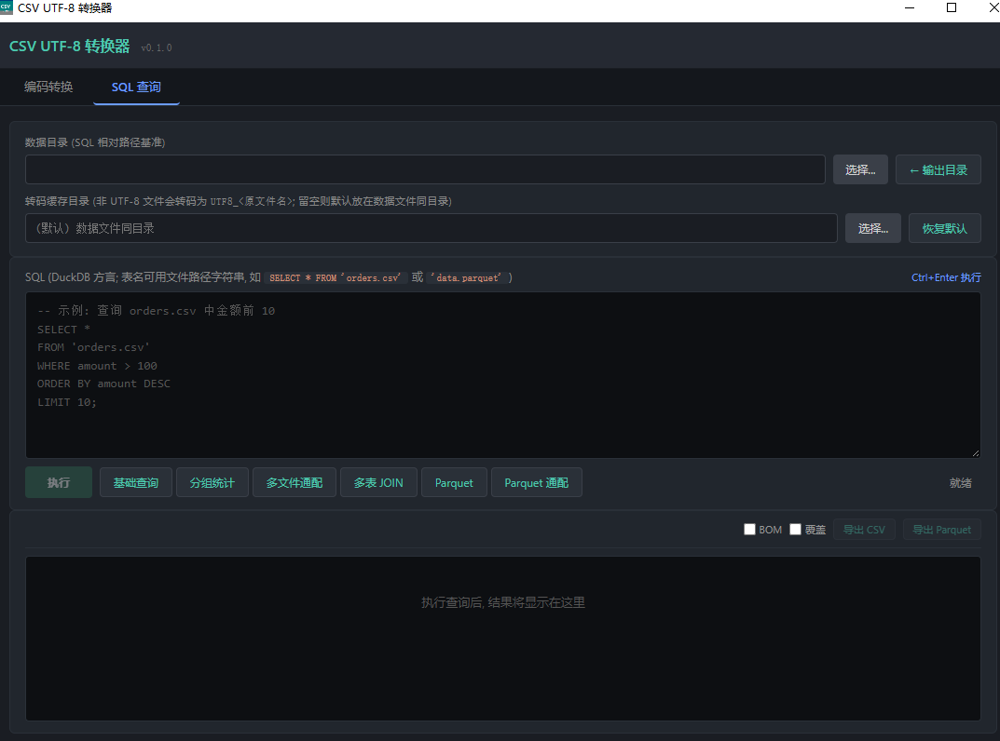

# CSV UTF-8 转换器

一个基于 **Tauri 2 + Rust** 的桌面工具，用于：

1. **批量编码转换** —— 转码前可逐个文件**预览原始编码与样例数据**，确认后再勾选，把任意编码的 **CSV / TXT** 文本文件统一转换为 **UTF-8 CSV 或 Parquet**；
2. **SQL 查询** —— 内置 DuckDB，可直接对任意编码的 CSV / TSV / TXT / Parquet 执行 SQL，并导出 CSV / Parquet。

前端为原生 HTML / CSS / JavaScript（无打包步骤），后端为 Rust。

---

## 界面预览

### 编码转换

转码前先预览：列出所有匹配文件，标注**原始编码**与**是否需转码**，展开即可看到**表头与 4 行样例数据**，据此决定勾选哪些文件。



参数、进度与日志区：输出格式（UTF-8 CSV / Parquet）、并发数、递归子目录、BOM 等开关，以及成功 / 失败 / 跳过 / 吞吐 / 已用统计。



### SQL 查询

DuckDB SQL 编辑器（`Ctrl+Enter` 执行）、常用查询预设按钮，以及结果表格预览与 CSV / Parquet 导出。



---

## 功能特性

### 一、编码转换

- **输入范围固定为 `.csv` / `.txt`**（大小写不敏感）；可勾选递归扫描输入目录，保留相对目录结构。
- **转码前预览**（`preview.rs`）：先扫描并列出匹配到的文件，每个文件展示**原始编码**、大小、**是否需要转码**；展开后可查看**表头 + 4 行样例数据**（文件不足 4 行时按实际行数）、嗅探出的分隔符与列数，用来判断该文件是否真的需要转码。
  - 只读取文件头部 **64 KB**，预览耗时与文件大小基本无关（4 GB 文件同样是毫秒级）。
  - 最多展示 **30 列**、单元格文本截断到 **120 字符**（超宽表仅提示"仅显示前 30 列"）。
  - **原始编码可手动纠正**：每个文件的编码是一个下拉框，默认「自动（探测结果）」；短文件或混合编码文件探测有误时，可直接改选 GB18030 / Big5 / UTF-16 等，**预览与后续转换都会按你选的编码执行**，不会出现"预览对了、转换还是错的"。
  - 提供「**仅选需转码** / 全选 / 全不选 / 全部展开 / 全部折叠」批量操作。
- **按勾选转换**：只对勾选的文件执行转换，**默认自动勾选"需转码"的文件**（已是 UTF-8 的不必重复处理）；未勾选的文件不会被处理。
- **统一输出格式**：通过界面「输出格式」选择，所有文件一律输出为 **UTF-8 CSV** 或 **Parquet**（输出扩展名随之变为 `.csv` / `.parquet`，与输入扩展名无关）：
  - **UTF-8 CSV**：文本形态，可选写 UTF-8 BOM（Excel 打开中文不乱码）。
  - **Parquet**：经 DuckDB 把已转码的 UTF-8 CSV 整表列式落盘（`COPY ... (FORMAT PARQUET)`），类型信息得以保留。
- **自动编码检测**（`detector.rs`），按优先级：
  1. BOM 标记（UTF-8 / UTF-16 LE / BE）；
  2. 探测窗口含非 ASCII → 严格 UTF-8 校验 → `chardetng` 启发式；
  3. 探测窗口纯 ASCII → 向后扫描整个文件找到首个非 ASCII 字节再判定  
     （修复"前段英文日志 + 后置中文的 GBK 文件"被误判为 UTF-8 的问题）；
  4. 全文件纯 ASCII → UTF-8；
  5. 中文环境保守默认 GB18030。
- **支持的编码**：UTF-8、UTF-8 BOM、UTF-16 LE/BE、GB18030、Big5、Shift_JIS、EUC-KR、Windows-1252。
- **流式转换**（`converter.rs`）：256 KB 滑动缓冲，内存占用与文件大小无关；临时文件 + 原子 `rename`，单文件失败不影响其他文件。
- **并行**：基于 `rayon` 多线程，可手动指定并发数（`0` = 自动）。
- **实用开关**：输出 UTF-8 BOM、跳过已是 UTF-8（二者仅 CSV 输出可用）、覆盖已存在文件；失败自动重试（固定 2 次，非开关）。
- **实时反馈**：成功 / 失败 / 跳过计数、吞吐（MB/s）、耗时、逐文件日志；支持取消。
- **源文件安全**：输入目录与输出目录不允许相同，源文件永不被修改。

### 二、SQL 查询（DuckDB）

- 对任意编码的 CSV / TSV / TXT / PSV 直接执行 SQL：先自动探测编码，非 UTF-8 的转码为 UTF-8（已是 UTF-8 的直接读取，不转码），再交给 DuckDB 内置 CSV 解析器。
- 支持 **Parquet**（自带编码，直接读取）。
- 支持多文件通配、多表 JOIN、分组统计等 DuckDB 完整方言；界面内置「基础查询 / 分组统计 / 多文件通配 / 多表 JOIN / Parquet / Parquet 通配」示例按钮，`Ctrl+Enter` 执行。
- 结果表格预览（默认截断到 1000 行），可将结果**导出为 CSV（可选 BOM）或 Parquet**（导出时会重新全量执行 SQL，不受预览截断影响）。
- 转码结果缓存为 `utf8_<原文件名>`，**默认放在数据文件所在目录**（如 `订单.csv` → `utf8_订单.csv`），也可在界面**手动指定统一的缓存目录**（此时按源文件路径哈希分子目录，避免同名冲突）；按源文件 `mtime` 判断是否过期，重复查询几乎零成本。**已是 UTF-8 的文件直接读取，不转码、不产生缓存。** 缓存不再写入系统临时目录。
- **离线可用**：预置 7 个 DuckDB 扩展（`json` / `parquet` / `icu` / `httpfs` / `fts` / `excel` / `spatial`），随安装包一起分发，断网也能加载。


---

## 技术栈

| 层            | 技术                                                  |
| ------------ | --------------------------------------------------- |
| 桌面外壳         | Tauri 2（含原生目录/文件对话框）                                |
| 后端           | Rust 2021（`rust-version = 1.90`）                    |
| 前端           | 原生 HTML / CSS / JavaScript（`withGlobalTauri`，无构建步骤） |
| 编码检测 / 转换    | `encoding_rs`（SIMD 加速）、`chardetng`                  |
| 并行 / 遍历 / 匹配 | `rayon`、`walkdir`、`glob`                            |
| 查询引擎         | `duckdb` 1.10506（`bundled`，捆绑 DuckDB API v1.5.6）      |

---

## 目录结构

```
.
├── dist/                      # 前端静态资源（Tauri frontendDist，无构建步骤，直接提交）
│   ├── index.html             # 前端页面（两个 Tab：编码转换 / SQL 查询）
│   ├── main.js                # 前端逻辑（Tauri invoke + 事件监听）
│   └── style.css              # 样式
├── docs/
│   └── screenshots/           # README 界面截图
├── .gitattributes             # Git LFS 规则（*.duckdb_extension）
├── .gitignore                 # Git 忽略规则
├── LICENSE                    # MIT 许可证
├── README.md                  # 项目说明
└── src-tauri/
    ├── Cargo.toml             # 依赖与 release profile
    ├── build.rs               # tauri-build 入口
    ├── tauri.conf.json        # 窗口 / 打包 / 前端资源（frontendDist）配置
    ├── capabilities/          # 权限声明（dialog 等）
    ├── icons/                 # 应用图标
    ├── gen/schemas/           # tauri-build 生成的 schema（自动生成）
    ├── tools/
    │   └── duckdb-extensions/ # 预置 DuckDB 扩展二进制（Git LFS 管理，离线 SQL 用）
    ├── src/
    │   ├── main.rs            # 程序入口
    │   ├── lib.rs             # Tauri 命令注册 + 批量转换调度
    │   ├── converter.rs       # 流式编码转换
    │   ├── detector.rs        # 编码检测
    │   ├── preview.rs         # 转码前文件预览（编码 / 表头 / 样例行）
    │   └── sql.rs             # DuckDB SQL 引擎 + 结果导出
    └── tests/                 # 集成测试
```

---

## 环境要求

- **Rust ≥ 1.90**（MSRV；建议 stable 工具链）。
- **Windows**：需要 MSVC 工具链（`cl.exe`）。
- **tauri CLI**（仅构建 / 开发时需要）：`cargo install tauri-cli --version "^2"`。
- **Git LFS**（仅克隆仓库时需要，用于拉取 DuckDB 扩展二进制）：`git lfs install`。
- 说明：`duckdb` 使用 `bundled` 构建，无需安装 `nasm`（详见 `src-tauri/Cargo.toml` 注释）。

---

## 构建与运行

开发模式（热重载）：

```bash
cd src-tauri
cargo tauri dev
```

直接运行（不经过 tauri CLI）：

```bash
cd src-tauri
cargo run
```

发布构建（产物在 `src-tauri/target/release/bundle/`）：

```bash
cd src-tauri
cargo tauri build
```

> **MSI 打包语言**：`tauri.conf.json` 中设置了 `bundle.windows.wix.language = "zh-CN"`。
> `productName` 含中文，而 WiX 默认 `en-US` 对应代码页 **1252（Latin-1）**，无法表示中文，会以
> `LGHT0311` 报错并导致 `light.exe` 打包失败；`zh-CN` 对应代码页 **936**，可正常打包。
> 注意 Tauri 内置模板只改代码页，**安装向导界面文案仍为英文**。

---

## 测试

```bash
cd src-tauri
cargo test
```

主要集成测试：

| 测试                                                  | 作用                              |
| --------------------------------------------------- | ------------------------------- |
| `preview_files.rs`                                  | 文件预览端到端（真实 GBK 文件的编码识别 / 表头 / 样例行） |
| `offline_extensions.rs`                             | 验证 7 个 DuckDB 扩展可**离线**加载并可用     |
| `sql_e2e.rs`                                        | SQL 查询端到端                       |
| `parquet_query.rs` / `repro_parquet.rs`             | Parquet 读取 / 复现                 |
| `export_test.rs` / `export_demo.rs`                 | 导出 CSV / Parquet                |
| `eval_drop_encodings.rs` / `eval_encodings_size.rs` | 编码检测评估                          |
| `extension_probe.rs` / `install_all.rs`             | 扩展探测 / 下载辅助（需联网）                |

---

## 离线 DuckDB 扩展

应用启动时会按**绝对路径**加载 7 个扩展：

| 运行方式 | 扩展目录 |
|---|---|
| 安装后 | `<安装目录>\resources\tools\duckdb-extensions\<版本>\<平台>\` |
| 开发期 | `src-tauri/tools/duckdb-extensions/<版本>/<平台>/` |

路径在 `run()` 的 `setup` 中通过 `app.path().resource_dir()` 解析后注入 `sql.rs`（`set_ext_dir`），开发期回退到 `CARGO_MANIFEST_DIR`。**不要**改回在编译期用 `env!("CARGO_MANIFEST_DIR")` 拼路径——那会把构建机的绝对路径写死进二进制，装到别人机器上必然找不到。

- 版本目录必须与 `duckdb-rs` 捆绑的 DuckDB API 版本严格一致（当前 `v1.5.6` / `windows_amd64`），否则 `LOAD` 会因版本校验失败。
- 若扩展缺失或加载失败，会**静默降级**为按需联网 `INSTALL`（结果记录在预加载报告中，见 `sql.rs`）。

获取 / 更新扩展：

1. 运行 `cargo test --test install_all`（走 DuckDB 官方 `INSTALL`，需联网）；
2. 从 `%USERPROFILE%\.duckdb\extensions\v1.5.6\windows_amd64\` 复制 `.duckdb_extension` 文件到 `src-tauri/tools/duckdb-extensions/v1.5.6/windows_amd64/`。

> **注意**：`tools/duckdb-extensions/` 约 196 MB，由 **Git LFS** 托管（规则见 `.gitattributes`）。克隆后若扩展文件仍是 133 字节的指针文件，执行 `git lfs pull` 恢复真实二进制。
>
> `encodings` 扩展已于 v0.1.0 移除（177 MB，占原载荷 48%，功能上从未被使用）。若确需恢复：`INSTALL encodings;` 后按上面第 2 步复制回来，并把它加回 `sql.rs` 的 `PRELOAD_EXTENSIONS`。

---

## 许可证

本项目基于 [MIT License](LICENSE) 开源，版权所有 (c) 2026 qianxkun。
